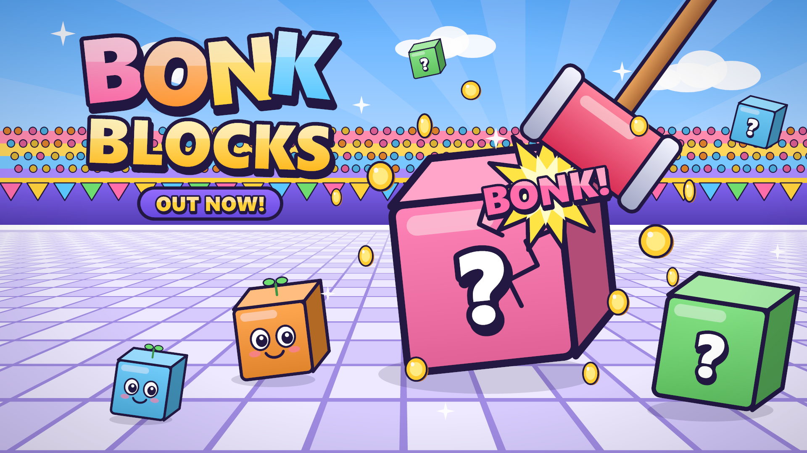

# Bonk Blocks



A multiplayer Roblox party game written in **Luau** and synced with **Rojo**: 60 modules (~13,000 lines) split into
server services and client controllers, server-authoritative economy with rate limiting and anti-exploit checks,
ProfileStore saving, unit tests for the shared logic, and a Studio smoke test.

**Stack:** Luau · Rojo · ProfileStore · luau-lsp · StyLua · Selene · PowerShell tooling

---

An 8-player, mobile-first physics party game. Players bonk giant mystery blocks
into their team's crusher. **Crack for cash, crush for points.**

- **Crack**: a block's HP hits 0 out in the open. It bursts into coins, split between everyone who damaged it (by damage dealt).
- **Crush**: a block is knocked into a crusher. That crusher's team scores, and contributors on that team get 1.5x coins.
- Blocks get bigger and tougher over the 3-minute round. Damaged blocks fly farther (Smash-style), so late-round blocks have to be crushed.
- With 4+ players it's Red vs Blue. With fewer it's **co-op**: the crew needs N crusher points before time runs out, and every crusher counts.

## File tree

```
BonkBlocks/
├─ default.project.json
├─ README.md
├─ ServerPackages/            <- put ProfileStore.luau here (step 2)
└─ src/
   ├─ shared/                 -> ReplicatedStorage.Shared
   │  ├─ Config.luau          all tunables: costs, timings, HP, sounds, debug
   │  ├─ Constants.luau       tag / attribute / remote names
   │  ├─ Types.luau           shared Luau types
   │  ├─ Net.luau             remotes (server creates, client waits)
   │  ├─ Signal.luau          tiny pure-Luau signal
   │  ├─ MathUtil.luau        lerp, box distance, number formatting
   │  ├─ HammerStats.luau     upgrade tiers -> damage/reach/knockback, costs
   │  ├─ Progression.luau     Blockling bonuses/slots, rebirth cost/multiplier, daily streak math
   │  └─ HammerPose.luau      grip poses for the swing tween
   ├─ server/                 -> ServerScriptService.Server
   │  ├─ Main.server.luau     requires -> Init() -> Start()
   │  ├─ Services/
   │  │  ├─ DataService.luau     ProfileStore sessions, Sync(), Increment()
   │  │  ├─ CoinService.luau     Add(player, amount, reason) / TrySpend; multiplier hooks
   │  │  ├─ ArenaService.luau    finds tagged arena parts; builds DevArena if none
   │  │  ├─ TeamService.luau     Teams, snake draft, late joiners, team spawns
   │  │  ├─ BlockService.luau    spawn, HP, knockback, crusher detection, payouts
   │  │  ├─ RoundService.luau    state machine, scores, bonuses, summary, welcome block
   │  │  ├─ UpgradeService.luau  validated purchases
   │  │  ├─ HammerService.luau   hammer welding + validated swings
   │  │  ├─ BlocklingService.luau drops, pity, grant, equip, coin bonus (week 2)
   │  │  ├─ RebirthService.luau  rebirth reset + permanent multiplier (week 2)
   │  │  ├─ DailyService.luau    7-day streak rewards (week 2)
   │  │  ├─ QuestService.luau    3 daily quests from server signals (week 2)
   │  │  ├─ EventService.luau    clock-synced server events + Mega Block boss
   │  │  ├─ EmoteService.luau    validated emotes + victory dance
   │  │  ├─ SocialService.luau   friends-in-server coin boost
   │  │  ├─ AchievementService.luau Roblox badges from game signals
   │  │  ├─ SettingsService.luau saved player toggles (sound, shake, big buttons)
   │  │  ├─ LeaderboardService.luau global top-10 board (OrderedDataStore)
   │  │  ├─ FunnelService.luau   onboarding funnel analytics (30s hook)
   │  │  └─ DebugService.luau    Studio-only playtest commands
   │  └─ Util/
   │     ├─ RateLimiter.luau   per-player token buckets + flood kick
   │     ├─ MovementGuard.luau teleport/speed sanity check for swings
   │     ├─ SmokeTest.luau     Studio-only startup self-test of the block pipeline
   │     └─ DevArena.luau      procedural test arena (correctly tagged)
   └─ client/                 -> StarterPlayerScripts.Client
      ├─ Main.client.luau
      ├─ Util/Ui.luau         instance builder + responsive UIScale
      └─ Controllers/
         ├─ ClientState.luau      read-only mirror of server attributes
         ├─ SoundController.luau  Config.Sounds by name, skips unset ids
         ├─ CameraController.luau screen shake (respects Reduce Motion)
         ├─ HudController.luau    coins, timer, scores, banners, toasts, summary
         ├─ EffectsController.luau sparks, crack stages, shards, coin fountain
         ├─ HammerController.luau BONK button, input, swing anim, SwingRequest
         ├─ ShopController.luau   upgrade panel + first-upgrade arrow
         ├─ TeamVisualsController.luau  red/blue character outlines in team rounds
         ├─ PetController.luau          equipped Blocklings follow every player (week 2)
         ├─ CollectionController.luau   PETS menu, collection grid, drop reveal (week 2)
         ├─ RebirthController.luau      rebirth strip/modal, overhead tags (week 2)
         ├─ DailyController.luau        DAILY button + 7-day popup + quests tab (week 2)
         ├─ EmoteController.luau        procedural R15 emotes, EMOTE picker, keys 1-5
         ├─ SocialController.luau       top-right INVITE / friend-boost button
         ├─ SettingsController.luau     gear button + sound/shake/big-button toggles
         └─ DebugController.luau        Studio-only debug buttons (F8)
tests/shared.spec.luau        unit tests + Config design rules (not synced)
tools/check.ps1, tools/test.ps1   luau-analyze type check / luau.exe test runner
```

## Setup

### 1. Rojo
```bash
cd BonkBlocks
rojo serve
```
In Studio, open the Rojo plugin and click **Connect** (localhost:34872).

> The Rojo CLI and the Rojo Studio plugin must be on the same version. If they differ, update the CLI
> (for example `aftman add rojo-rbx/rojo@<plugin version> --global`) so plugin and server match.

Rojo only manages `ReplicatedStorage.Shared`, `ServerScriptService.Server`,
`ServerScriptService.ServerPackages` and `StarterPlayerScripts.Client`. Everything you
build in Studio (arena, assets) lives in the place file, so **save the place** (File → Save to Roblox).

### Editor setup (optional)
`.vscode/` recommends **luau-lsp** (configured for Roblox + a Rojo sourcemap, so it understands
`script.Parent` requires), the Rojo extension, **StyLua** (`stylua.toml` matches this code: tabs, 120 cols)
and **Selene** (`selene.toml`, Roblox std). `.gitignore` skips generated sourcemaps and the downloaded ProfileStore.

### 2. Install ProfileStore
1. Go to the official repo, **github.com/MadStudioRoblox/ProfileStore**, and open **Releases**.
2. Download `ProfileStore.luau` from the latest release. It's the single module source. If the release only ships an `.rbxm`, take `src/ProfileStore.luau` from that release's tag instead.
3. Save it as `BonkBlocks/ServerPackages/ProfileStore.luau`. The filename must be exactly `ProfileStore`.
4. Rojo syncs it to `ServerScriptService.ServerPackages.ProfileStore`. If it's missing, the server stops with a clear error.

To test real saving in Studio, publish the place, then turn on
**Game Settings → Security → Enable Studio Access to API Services**. Without access,
DataService falls back to `ProfileStore.Mock` and prints a warning: you can play, but nothing persists.

### 3. Game Settings
- **Max Players: 12** (Bonk Stadium is sized for 6v6)
- **Lighting → Technology = Future** (set in Studio's Explorer; scripts can't change it). The server applies the cartoon daylight, atmosphere, bloom and color grade itself (`Config.Visuals.ApplyLighting`).
- Avatar: R15 or R6 both work (the hammer welds to `RightHand` or `Right Arm`).

## Studio objects

**Zero-setup option:** if nothing is tagged, the server builds a tagged **DevArena** at runtime,
so you can press Play right away. It's **Bonk Stadium**: a 220x140 sports field at Y=10 (mowed stripes, touchlines, halfway line, center circle, a box in front of each
crusher, team end zones with RED/BLUE painted in them, corner flags, floodlight towers, pennant bunting) with glass walls, team crusher machines
(spinning rollers and teeth), bleachers, two leaderboards, a giant BONK BLOCKS sign, and a terrain island with hills, water, trees and
floating mystery blocks. It removes the template's Baseplate and SpawnLocation, so no grey baseplate shows.
Use it as the reference for your own build.

**Your own arena.** Tag parts with **Properties → Tags → +**. Add attributes with
**Properties → Attributes → + (type String)**.

| What | Build | Tag | Attributes / properties |
|---|---|---|---|
| Floor + walls | Anchored parts. About 160x100 studs for 12 players, with walls on the long sides. | none | normal collision |
| **Red crusher** | An invisible box covering the trough/pit at one end. It must cover the space a block occupies once it's over the edge, about 26 studs tall. | `Crusher` | `Team` = `Red` (String). Anchored, Transparency 1, CanCollide/CanTouch/CanQuery **off** |
| **Blue crusher** | Same, at the other end | `Crusher` | `Team` = `Blue` |
| Crusher visuals | Trough floor, end wall, any Creator Store crusher/teeth model | `CrusherVisual` (optional) | `Team` = `Red`/`Blue`. Anchored parts. Tagged parts dip and spring back each time their crusher eats a block (in co-op, all of them). Keep CanCollide off if they sit inside the pit. |
| **Block spawn zone** | An invisible flat part about 35-40 studs above the floor, covering the play area minus the crushers | `BlockSpawnZone` | Anchored, Transparency 1, CanCollide/CanTouch/CanQuery **off** |
| **Team spawns** | Thin pads on the floor. Put Red on the half *away* from the Red crusher, so Red naturally pushes toward it. | `TeamSpawn` | `Team` = `Red` / `Blue` (leave it off for "any team"). CanCollide off |
| SpawnLocation | One, anywhere on the floor | none | `Neutral` = true, `Duration` = 0. Players get moved to their team pads anyway. |

How detection works: a block is crushed when its **center point** enters a `Crusher`
volume (checked 10x/sec on the server, no `.Touched`). Blocks below `Config.Blocks.KillY` (-50) vanish.
If you delete the Baseplate, keep the arena above `KillY`.

**Optional assets** (Creator Store is fine). Create `ServerStorage/BonkAssets`:
- `BonkAssets/Hammer`: a **Model** with **PrimaryPart** = the handle (long axis = Y, grip near the bottom). Weld its parts together with WeldConstraints. The script makes it massless and non-colliding, and scales it for the Size upgrade.
- `BonkAssets/Blocks/<VariantId>` (`Mystery`, `Bouncy`, `Golden`) or `BonkAssets/Blocks/Default`: a single **Part/MeshPart**, not a Model. It's resized to the block size, and the server owns its physics.
- Swing animation: publish or own an Animation, then set `Config.Hammer.SwingAnimationId`.
- Sounds: paste audio ids into `Config.Sounds`. Unset ids are skipped silently.
- Crack decals: `Config.Vfx.CrackTextures = { "rbxassetid://...", "rbxassetid://..." }`.

## Test checklist

**Studio → Test → Clients and Servers → 2 players.** For quick runs, set `Config.Debug.RoundTime = 45`.
To test team mode with only 2 players, set `Config.Debug.ForceMode = "Teams"` (exact casing).

The 30-second hook (Player 1, fresh data):
- [ ] You spawn on the arena with no menu. A small block lands in front of you within about 5s.
- [ ] Two bonks crack it: shards, coin fountain flying to you, "+45", screen shake.
- [ ] The coin counter pops. An "UPGRADE!" arrow bounces next to the Upgrade button, with a toast. All within about 30s.
- [ ] Buying Power works **mid-round** (first purchase only). Damage numbers go up.

Round flow:
- [ ] Waiting → 4s countdown with 3-2-1 → round: banner + timer. Co-op shows `CREW 0/10` with 2 players.
- [ ] A dark shadow appears under every falling block (it shrinks and darkens as the block nears the ground). Big drops thud with dust and a small shake. Hammers leave a pink swoosh on each swing, for your own hammer and other players'.
- [ ] After the first hit, an HP bar appears over the block (green → gold → red) and drains with each bonk, for every player.
- [ ] Blocks grow over the round. Knocking one into a crusher → "+N CRUSHED!" in the team's color, score goes up by N.
- [ ] Co-op ends early when the target is hit. Otherwise it ends at 0:00 → summary (your stats + MVP) → 15s warm-up → next round starts by itself.
- [ ] With ForceMode Teams: the players split Red/Blue, each gets moved to their pad, the hint names their crusher, and only that crusher's team scores. Every character gets a red/blue outline during the round, and the outlines disappear in warm-up and summary.

Economy and security:
- [ ] Try buying during a round after your first upgrade → "The shop opens between rounds!". Buying works during warm-up/summary.
- [ ] Can't afford → the button shakes and a toast appears. The server refuses even if you call it from the client command bar:
      `game.ReplicatedStorage.BonkRemotes.PurchaseRequest:FireServer("power")` (spam it: nothing breaks).
- [ ] Spam `game.ReplicatedStorage.BonkRemotes.SwingRequest:FireServer()` in a client loop → at most about 2 hits/sec land. Set `Config.Debug.LogRejectedRemotes = true` to watch the rejections.
- [ ] Two players hit one block → both get coins, proportional to damage. Nobody gets paid twice.

Leaving, data, race conditions:
- [ ] Player 2 leaves mid-round while damaging a block → Player 1 still gets their share, and the server shows no errors.
- [ ] Coins, upgrades and `totalBlocksCrushed` persist after stopping and replaying (needs API access).
- [ ] Stop the server while a round is running → no data-loss warnings in output (BindToClose).

Phone emulation (**Test → Device**: iPhone 14 / Galaxy S landscape, plus a tablet):
- [ ] The BONK button is big, bottom-right, left of the jump button, and never overlaps it. Holding it auto-swings.
- [ ] The coin pill, timer/score bar, Upgrade button (left-middle) and shop panel all fit the screen and are thumb-sized.
- [ ] PC: Click / E / F swing, **U** toggles the shop, and the key hint under BONK changes when you switch devices.
- [ ] Gear button (right of the coins) → turn Sound effects / Screen shake OFF → rejoin → they're still OFF (saved in the profile).
- [ ] "Big buttons" ON → the HUD grows about 20% and BONK about 25%, instantly. It still fits a phone screen.
- [ ] Rapid hits on one block → "x3 COMBO!" and up (gold → orange → red at 10). It vanishes 1.6s after your last hit.
- [ ] Win a round (co-op target or more team points) → confetti over your character during the summary.
- [ ] On a 1080p PC window (UI scale 1.5) the gear, coin pill, top bar and toasts never overlap.

## Global leaderboard

Tag any part `Leaderboard` and it shows a global top 10. Optional String attributes: `Stat` = `Crushed`
(default, blocks crushed) or `Rebirths`, and `Face` = `Front`/`Back`/`Left`/... (default `Front`). The DevArena has
TOP CRUSHERS on the +Z wall and TOP REBIRTHS on the -Z wall. Scores go to the OrderedDataStores
`BonkBlocks_TopCrushers_v1` / `BonkBlocks_TopRebirths_v1` every 60s (16 writes/min for a full server, well within budget).
In Studio without API access the board says "Leaderboard offline". That's expected.

## Analytics: is the hook working?

`FunnelService` logs Roblox's **onboarding funnel** for brand-new players only (no blocks broken, no upgrades):
`Joined → FirstSwing → FirstHit → FirstCrack → CanAffordUpgrade → FirstUpgrade → FinishedRound`.
It also logs custom events `SecondsToFirstCrack` and `SecondsToFirstUpgrade` (targets: ≤15s and ≤30s).
See **Creator Dashboard → your experience → Analytics → Funnels / Custom events**. Events only appear for
published experiences. In Studio the steps print to Output when `Config.Debug.LogFunnel = true`.

## Anti-cheat: movement guard

`MovementGuard` samples every HumanoidRootPart 4x/sec. Horizontal speed above `Config.AntiCheat.MaxHorizontalSpeed`
(70 studs/s; normal walking is 16) flags the player, and their swings are refused for `PenaltySeconds`.
That stops "teleport next to a block and bonk". The server's own spawn teleports call `NoteTeleport` first,
so they never count as violations. Test it: in a client, run
`game.Players.LocalPlayer.Character:PivotTo(CFrame.new(0, 20, 0))` repeatedly → Output shows `[MovementGuard]` warnings.

## Type check (luau-analyze)

`tools/check.ps1` runs the official `luau-analyze` (luau-lang/luau releases, `luau-windows.zip`) on temp copies of `src`.
It prepends one line of Roblox stubs (`game`, `Vector3`, `Player`... typed `any`) and rewrites
`require(script.Parent...)` into string requires, so modules type-check together. Line numbers are mapped back to your files.
Use **absolute paths**. `-Work` is **deleted and recreated** on every run, so point it at a throwaway folder:

```bash
powershell -ExecutionPolicy Bypass -File C:\path\BonkBlocks\tools\check.ps1 -Src C:\path\BonkBlocks\src -Analyzer C:\tools\luau\luau-analyze.exe -Work C:\Temp\bonk-check
```

Add `-Mode strict` for the pickier mode. Last run (luau 0.744): 0 syntax errors and 0 nonstrict issues.
Strict mode reports typing noise only: untyped Config dictionaries, nil-initialized remote locals, and the generic Signal.
For full Roblox types in-editor, use the luau-lsp VS Code extension with a Rojo sourcemap.

## Unit tests (luau.exe)

`tests/shared.spec.luau` checks the pure shared modules (`MathUtil`, `HammerStats`, `Signal`) and your
**design rules in Config**: welcome block + first-crack bonus ≥ cheapest upgrade (30s hook), welcome block
cracks in ≤3 starter bonks (15s hook), costs and values strictly increase, the rate limit is above the legit
swing rate, and CrackStages descend. Re-run them after every balance change:

```bash
powershell -ExecutionPolicy Bypass -File C:\path\BonkBlocks\tools\test.ps1 -Root C:\path\BonkBlocks -Luau C:\tools\luau\luau.exe -Work C:\Temp\bonk-tests
```

`luau.exe` comes in the same `luau-windows.zip`. `-Work` is wiped every run. Last run: 13 passed, 0 failed.

## Studio smoke test (first thing to look at when you press Play)

With `Config.Debug.SmokeTest = true` (Studio only), the server self-tests the real block pipeline the moment it
starts, with no players needed. It checks the arena tags, spawns a block, hits it (damage, knockback, HP attribute),
cracks it, drops one into a crusher (checking the 10 Hz detection), despawns one, and rolls Blocklings 300 times
(every roll is a real species, and min-rarity rolls respect the floor). Output shows
`[SmokeTest] 12/12 passed` (the 12th check covers the event-block spawn path), or `FAIL <step> (<error>)` warnings
that point straight at the broken step.
A fake attacker (UserId -1) is used, so nobody earns coins.

## Studio debug panel

In Studio only, a small panel sits on the right edge (F8 toggles it): **+500 coins**, **+10k coins** (rebirth test),
**Skip phase** (ends the countdown/round/summary now), **Drop block** (a soft block in front of you), **Get Blockling**,
**Daily ready** (makes the next daily claim available now), **Finish quests**, **Start event** (runs the next
server event now), and **Reset me**. Reset me wipes coins, upgrades, crush
count, rebirths, Blocklings and the daily streak, then drops a new welcome block, so you can re-test the whole hook.
The server ignores `DebugCommand` on live servers (`RunService:IsStudio()` check), and live clients never build the panel.

## Race conditions and exploit review

| Risk | Handling |
|---|---|
| Player leaves mid-round | Payouts only go to contributors still in game with loaded data. Per-player tables are cleaned in PlayerRemoving (cooldowns, rate buckets, stats, teams). Coin-fountain coins whose target left just vanish. |
| Data not loaded yet | Swings and purchases are rejected until the profile is active. `CoinService.Add` returns 0 without a profile. The UI shows `...` until `DataLoaded`. All services loop over players who joined before the scripts ran. |
| Double rewards | `BlockService.Resolve` sets `resolved` before anything else, and nothing in it yields, so crack and crush can't both pay. Purchases do TrySpend + tier bump in one frame. FirstCrackBonus is gated on `totalBlocksCrushed == 0`, which is incremented in the same frame. |
| Remote spam | Token buckets (6/s swing, 3/s purchase), a server cooldown per player, type checks on every argument, and a kick after 120 drops in 10s. |
| Client lies about target or damage | The client only sends "I swung" plus an optional block *hint*. The server computes damage and knockback from saved upgrades and re-checks reach and arc against server positions. |
| Block flinging | Blocks are server network-owned (`SetNetworkOwner(nil)`). Hammers are massless and non-colliding. |
| Session stolen by another server | `OnSessionEnd` → kick, so the old server can't keep writing. |
| Server empties mid-round | The loop aborts to Waiting, clears blocks and teams, and the next player gets the short first countdown. |
| Shutdown | `BindToClose` ends every session (ProfileStore also flushes on shutdown). |

Known limits (fine for week 1): character position is trusted from the client, as it is in
every Roblox game, so teleport/speed checks belong in a later anti-cheat pass. Player list
attributes show everyone's coins (display only, never read by the server).

## Design decisions I made

- **First upgrade can be bought mid-round.** The spec says "buy between rounds", but it also wants an arrow at the first upgrade by 30s, while the round is live. `Config.Upgrades.FirstPurchaseAnytime = true` allows only a player's very first purchase at any time. Set it to false for strict between-rounds buying.
- **Welcome block + first-crack bonus** guarantee the 30s hook even when someone joins mid-round or during warm-up: an 18 HP block 9 studs in front, 20 coins + 25 bonus ≥ the 25-coin first upgrade.
- **Warm-up blocks during the lobby countdown**, so the arena is never empty ("spawn into a live arena"). Warm-up crushes pay coins but never score.
- **`hammerLevel` is saved, plus an `upgrades` table** (`power/size/knockback` tiers). `hammerLevel = 1 + total tiers`, for matchmaking and leaderboards later. Team assignment already uses it for a fair snake draft.

## Week 2: Blocklings, Rebirth, Daily rewards

All three run on the week 1 hooks: `BlockService.BlockResolved` (drops), `CoinService.RegisterMultiplier`
(bonuses), `CoinService.Add(player, amount, reason)` (every grant) and the saved `rebirths` field. The shared math
lives in `src/shared/Progression.luau`, so the server, the UI and the unit tests agree.

### Blocklings (collectible pets)
- **12 original critters** in 5 rarities (`Config.Blocklings.Species`): Pebbit, Brickle, Mossy, Puddle, Toasty, Bubblegum, Quartzy, Frostcube, Sparky, Lavalump, Goldie and Cosmo. They're built procedurally (cube body, googly eyes, feet, accessories: leaf, horns, spikes, crown, halo), so no assets are needed. For real art, put a Model named `<Id>` with a PrimaryPart in `ReplicatedStorage/BonkAssets/Blocklings/`.
- **Drops**: every contributor to a cracked or crushed block rolls `DropChance` (5%). That's x3 on Golden blocks, x1.5 on Bouncy, and x1.5 for crushes. A player's **first Blockling is guaranteed by their 3rd broken block** (hook), and a **pity timer** guarantees one every 40 blocks.
- **Duplicates level up** the species (max Lv 5, +25% of its bonus per level).
- **Collection sets**: own every species of a rarity and get **+5% earned coins forever**, equipped or not. The collection header shows "Sets x/5", and a toast announces each completed set.
- **Equip** gives an earned-coin bonus (+3% Common up to +35% Legendary). There's 1 slot, +1 at Rebirth 1 and +1 at Rebirth 3. Bonuses apply to block and round coins only (`BonusReasons`), never to daily or first-crack bonuses.
- **UI**: PETS button (left menu, or **P**) → collection grid with 3D portraits, silhouettes for species not yet found, levels, bonuses, and Equip/Unequip. When one drops, it pops out of the block, hops to you, and a reveal card shows "NEW BLOCKLING!" or "LEVEL UP!". Equipped Blocklings follow every player as hopping pets, rendered client-side from the `Equipped` attribute.

### Rebirth
- The strip at the bottom of the Upgrade panel opens a confirm modal: **cost 10,000 coins, doubling each time**. You lose coins and hammer upgrades. You keep Blocklings, crush count and daily streak. You gain **+25% earned coins forever** per rebirth, plus Blockling slots.
- Between rounds only (`Config.Rebirth.BetweenRoundsOnly`). The server does spend + reset + increment in one frame. Everyone sees "X reached Rebirth N!", and rebirthed players get a gold **REBIRTH N** tag over their head.
- After rebirthing, the first-upgrade-anytime exception no longer applies.

### Daily rewards
- A 7-day track (`Config.Daily.Rewards`): 50 → 800 coins, and **day 7 adds a Rare-or-better Blockling**. Coin rewards scale x(1 + 0.5 × rebirths).
- You can claim every **20 hours**. Missing **48 hours** restarts the streak at day 1. Only server `os.time()` is used, so changing the device clock does nothing.
- The DAILY button shows a countdown, or a badge when ready. The popup auto-opens once per session, for **returning players only** and **never during a live round**, so it can't interrupt a new player's 30-second hook.

### Daily quests
- Every UTC day each player gets **3 quests** from `Config.Quests.Pool`: crack 5, crush 3, deal 600 damage, swing 120 times, win a round, break a Golden block, find a Blockling, buy an upgrade. Rewards are 100–300 coins, x(1 + 0.5 × rebirths).
- Progress comes **only from server signals** (`BlockResolved`, `BlockHit`, `Swung`, `RoundFinished`, `Granted`, `Upgraded`). The client can't report progress. Claiming marks the quest claimed before paying, so it can never pay twice.
- They're shown in the DAILY popup's **QUESTS** tab, with progress bars, CLAIM buttons and a countdown to the next roll. The DAILY badge lights for a ready daily reward or a finished quest, and you get a toast when a quest completes.

### Week 2 test checklist (Studio, use the F8 debug panel)
- [ ] DAILY → QUESTS shows 3 quests. Crack blocks → the "Crack 5" bar fills → toast "Quest complete!" → badge → CLAIM → +coins, row shows DONE. Click CLAIM again → nothing (already claimed). "Finish quests" → all claimable.
- [ ] Fresh player (Reset me): by the 3rd broken block a Blockling pops out of it, hops to you, and the "NEW BLOCKLING!" card shows. It's auto-equipped and follows you as a pet. The PETS button gets a badge.
- [ ] Get Blockling ×5 → duplicates show "LEVEL UP!". The collection shows levels and bonuses. The summary line shows Found x/12, Slots and +% coins.
- [ ] With 1 slot full, Equip another → "All slots full" toast. Unequip, then equip it → the pet swaps for both clients.
- [ ] Bonus check: with an equipped Blockling, crack a block → the coin popup is bigger than without one (compare by unequipping).
- [ ] +10k coins → the rebirth strip turns gold → modal → REBIRTH → coins 0, upgrades Lv 0, hammer back to base size, banner "REBIRTH 1!", other client gets a toast, gold tag over your head, Slots 2. During a live round the modal says "Rebirth between rounds".
- [ ] DAILY → claim day 1 (+50) → button shows a countdown. "Daily ready" → claim day 2. Repeat to day 7 → coins + a Rare+ Blockling reveal. Rejoin → streak saved.
- [ ] Everything above persists after rejoining (needs API access).

## Update 3: events, animations, mutations, friends (for growth)

See **LAUNCH.md** for why each of these exists and how to market it.

### Server-wide events (`Config.Events`, EventService)
- Every **10 minutes on the real clock**, every server runs the same event: `MegaBlock → GoldenRain → MoonGravity → MegaBlock → Bonanza → MeteorShower → MegaBlock → CoinFrenzy → BouncyHour` (a 90-minute cycle that repeats, with a Mega Block every 30 min). `Progression.EventSchedule(now)` is a pure function of time, so clients show **"Next: MEGA BLOCK in 4:12"** with no remote. A toast warns 60s before, and a big banner shows at the start.
- **MEGA BLOCK**: a 20-stud co-op boss (HP 500 + 600 per player) with a top-of-screen HP bar. Every contributor gets coins by damage share and a **guaranteed Uncommon+ Blockling**. If nobody breaks it within 2 minutes it **escapes**. Round transitions don't clear it.
- **GOLDEN RAIN** makes every block Golden (x3 coins). **MOON GRAVITY** drops `workspace.Gravity` to 60. **BONANZA** gives Blockling drops x3 and mutations x2. **METEOR SHOWER** rains tiny 1–2-hit blocks. **COIN FRENZY** doubles earned coins for 60s. **BOUNCY HOUR** makes every block Bouncy.

### Animations
- **Emotes**: Wave, Cheer, Flex, Spin and Bonk Dance. They're procedural, so no uploaded animations are needed: each client poses the R15 joints (`Motor6D.Transform` in `RunService.Stepped`) of anyone with the server-set `Emote`/`EmoteAt` character attributes, so everyone sees the same moves. Use the **EMOTE** button next to BONK, or keys **1–5**, or **G** for the picker. Walking cancels. Original moves only, no copyrighted dances. R6 avatars are skipped.
- **Victory dance**: the winning team auto-dances on the results screen (good for screenshots).
- **Impact frames**: when your bonk breaks a block, you get one desaturated high-contrast frame, a white pop and an FOV punch, stronger on a Mega Block. **Speed lines** appear at combo 8+. Both turn off with the Screen shake setting.

### Player bonks (`Config.Hammer.PlayerBonk`)
- Swing with **no block in reach** and you launch the nearest player in front of you, cartoon-style with no damage, a "BONK!" pop and a shake. The server picks the target and validates reach and arc. The victim's client applies the launch, since it owns that character's physics.
- **Guardrails:** Teams mode is enemies only. Each victim can be bonked once per 2.5s (no stun-lock), and there's **45s spawn protection**, which also protects a new player's 30-second hook. The launch speed stays under the movement guard's limit, so victims are never flagged. There's a quest for it: "Bonk other players 5 times".

### Blockling mutations
- Every drop rolls **Shiny** (1/20, x2 bonus, gold sparkles) or **Rainbow** (1/150, x3, color-cycling and rainbow sparkles). A species keeps its best mutation. A Rainbow is announced to the whole server.

### Friends, invites, badges
- **+10% earned coins per friend** in your server (max +50%, 5 friends), checked on the server with `IsFriendsWith`. The top-right **INVITE** button opens Roblox's invite prompt and shows the live boost.
- **Badges** (`Config.Badges`, 0 = not set up): FirstCrack, FirstBlockling, MegaBlock, FirstWin, FirstRebirth, Rainbow, FullCollection.

### Update 3 test checklist
- [ ] The top bar shows "Next: <EVENT> in m:ss" and counts down. F8 → **Start event** cycles events immediately.
- [ ] MEGA BLOCK: a giant pink "!!" block drops in the middle, the HP bar appears and drains, then "MEGA BLOCK DESTROYED!". Everyone who hit it gets a Blockling reveal and a big impact frame. If you leave it alone for 2 min, "IT ESCAPED!".
- [ ] GOLDEN RAIN: new blocks are gold. MOON GRAVITY: big jumps, floaty blocks, then gravity returns after 60s. METEOR SHOWER: small blocks rain down. BONANZA: Blocklings drop often.
- [ ] Press 1–5 (or EMOTE → pick): your character performs it. Walk → it stops. With 2 clients, the other client sees the same emote. Win a round → the winners dance.
- [ ] Combo 8+ → speed lines. Turn Screen shake off → no speed lines and no impact frames.
- [ ] Get Blockling repeatedly until "SHINY!" shows: the pet sparkles, and the collection shows "Shiny <Name>" with a doubled bonus.
- [ ] The INVITE button opens Roblox's invite prompt. (The friend boost needs real friend accounts; Studio test players aren't friends.)
- [ ] 2 clients, after 45s: walk up to the other player with no block nearby and BONK → they fly, with a "BONK!" pop. Bonk again right away → nothing (2.5s cooldown). With ForceMode Teams: teammates can't be bonked, enemies can. Output shows no `[MovementGuard]` warning for the victim.

## Update 4: presentation (stadium, lighting, intro, RELEASE card, UI polish)

- **Bonk Stadium** (DevArena): 2.5x the old area, for 12 players. Block caps and spawn rates were raised to match (`MaxActiveCap` 14), and the Mega Block is now 24 studs.
- **Lighting**: bright cartoon daylight, Atmosphere haze, bloom on neon, a light color grade and sun rays (`Config.Visuals.ApplyLighting`). It reuses the template's own Atmosphere/Bloom if they exist.
- **Ambient motion**: crusher rollers spin and floating blocks bob and turn. Tag your own parts `Spin` (`SpinSpeed`, `SpinAxis`) or `Bob` (`BobHeight`, `BobSpeed`).
- **Intro**: cinematic letterbox, the camera orbits the stadium, the BONK BLOCKS logo pops in, and a big pulsing **PLAY** button (auto after 12s). The camera then swoops behind your character. Set `Config.Debug.SkipIntro = true` for fast Studio loops.
- **RELEASE!! card**: shown once per `Config.Release.Version` after the intro, and any time from **UPDATES** (top-right, under INVITE). It lists what's in the game plus a one-line how-to-play. **Bump `Version` and edit `Items` with every update**, and returning players see it automatically.
- **The 30-second hook is preserved**: the server only drops the welcome block once the client reports it's past the intro and release card (`ClientReady`, 45s fallback). The daily popup waits for that too.
- **UI polish**: every rounded button and panel gets a glossy top-to-bottom shading, and big panels get drop shadows (`Config.Visuals.UiPolish`).

### Update 4 test checklist
- [ ] Press Play: letterbox bars, the camera circling the stadium, the logo popping in → PLAY → the camera swoops behind you → the RELEASE!! card → LET'S BONK! → a welcome block drops within a few seconds.
- [ ] Play again: the RELEASE card doesn't show (saved). Click UPDATES (top-right) and it opens.
- [ ] No grey baseplate anywhere. Water, an island, trees, floating blocks, spinning crusher rollers.
- [ ] Phone emulator: the intro, the PLAY button and the RELEASE card all fit on screen.

## Update 5: what the top 2025-26 games do (research-driven)

From the research report (`../reports/Roblox high CCU design trends.md`): peaks come from **weekly scheduled events**, **rare pulls shouted to the server**, a fast first reward, and **playing with friends**.

- **BONK PARTY, every Saturday 18:00-18:30 UTC** (`Config.Events.WeeklyParty`). It overrides the 10-minute rotation on every server at once: x2 coins, x3 Blockling drops, x2 mutation chance, and a new MEGA BLOCK 15s after each one is destroyed. It's still the pure `Progression.EventSchedule(now)`, so the countdown works with no remote. Announce it in your group and Shorts: it's the weekly peak.
- **Event boosts are generic**: any `Config.Events.Defs` entry with `CoinMultiplier`, `DropMultiplier` or `MutationMultiplier` applies it (the `EventCoins` multiplier and `BlocklingService.SetEventBoost`), so a new event needs only Config.
- **First Blockling by the 2nd broken block** (`FirstGuaranteedAt = 2`): the first pet now lands inside the first-minute bounce window the algorithm measures.
- **Friend boost cap raised to +50%** (5 friends), the cap top games use.
- **Rare-pull shouts**: a player's first-ever Epic or Legendary is announced to the whole server, like Rainbow mutations.

### Update 5 test checklist
- [ ] Unit tests: `weekly BONK PARTY overrides the rotation...` passes.
- [ ] Fresh data (F8 → Reset me): your first Blockling appears by your 2nd broken block.
- [ ] Temporarily set `WeeklyParty.WeekdayUTC`/`HourUTC` to now (UTC): the top bar shows BONK PARTY, a Mega drops, and ~15s after it's destroyed another drops. Coin popups are doubled. Set it back.
- [ ] Find an Epic or Legendary: the other client gets a gold "<name> found a LEGENDARY ...!" toast.

## Update 6: wider court, new floor, UI effects, new intro, store art

- **Court 240 x 180** (was 220 x 140) with a **lilac checkerboard floor** instead of grass inside the arena, a pink BONK! center badge, and team chevrons pointing at each crusher. A **paved plaza** surrounds the stadium. The island grass is a brighter cartoon green, and it no longer fills the crusher troughs (it used to, burying the rollers).
- **UI effects** (`Config.Visuals.UiFx`, UiFxController): buttons squash when pressed and spring back, earned coins fly from your character into the coin counter, and shine sweeps run across the BONK, PLAY and LET'S BONK buttons. The RELEASE card and PLAY button have spinning gold/rainbow borders. The helpers are `Ui.shine(obj, period)` and `Ui.animatedStroke(stroke, colors, seconds)`.
- **Intro**: fades in from black, the letterbox slides in and the camera swoops down into the orbit. B-O-N-K pop in one by one and wave, BLOCKS slams down with a shake, sunburst rays spin and mystery blocks float up. PLAY triggers a "LET'S BONK!" wipe that cuts to your character.
- **Store art** in `marketing/` (icon 512, thumbnail 1920x1080, transparent logo, description). Redraw it with `tools/marketing.ps1`.

- **No grass anywhere**: on build, DevArena clears all terrain (including a template's Flat Terrain grass) and turns off grass decoration. The island top is now pastel paving. An old DevArena saved into the place is replaced automatically.
- **Around the arena**: a ring of 16 giant candy-colored trees (green, blossom, mint, lilac) in white flower planters, 4 stacked mystery-block towers with a spinning block on top, and a giant team-colored hammer smashed into the plaza behind each crusher.
- **Sky**: volumetric pastel clouds (Terrain `Clouds`), a lilac atmosphere with a big soft sun, a neon rainbow arching out of the sea behind the title sign, 5 bobbing floating islands, and a pink "BONK BLOCKS" blimp circling overhead (new `Orbit` tag in AmbientController).

- **Final VFX** (UiFxController, WorldFxController): paper confetti bursts (new Blockling, rebirth, round win), a red screen-edge heartbeat in the last 10 seconds, an edge flash in the event's color when a server event starts, pastel sparkles drifting over the court, and fireworks over the stadium at round end (`Config.Vfx.Fireworks` / `AmbientSparkles`).
- **Publishing**: step-by-step guide in **PUBLISH.md**.

### Update 6 test checklist
- [ ] Last 10 seconds of a round: the screen edges pulse red each second. Round ends: fireworks over the court, and confetti from the corners if your team won.
- [ ] Look around from the court: no grass anywhere, giant trees and block towers past the stands, hammer statues behind both crushers, rainbow behind the title sign, the blimp circling, clouds overhead.
- [ ] Play: the intro sequence above, then the RELEASE card with a shimmering gold border.
- [ ] No grass inside the arena. Blocks that fall into a crusher drop onto the trough floor next to the spinning rollers.
- [ ] Break a block: gold coins burst from your character into the coin counter, which pops and shines.
- [ ] Tap any HUD button: it squashes and bounces back.

## Week 3: what's next

0. **Ship it**: follow LAUNCH.md (icon/thumbnail A/B tests, sounds, badges, a 3-day Sponsored Ads test, daily Shorts).
1. **Monetization** (still off by request): gamepass 2x coins as `RegisterMultiplier("Gamepass2x", ...)`, dev products via `MarketplaceService.ProcessReceipt` → `CoinService.Add(player, n, "DevProduct:<id>")` with receipt dedupe in the profile, extra pet slot pass, cosmetic hammer skins.
2. **Blockling depth**: fuse 3 duplicates past max level into a Shiny variant, a trading UI (with server-side two-step confirm), pet abilities (a small knockback aura, a coin magnet).
3. **Offline income**, if it fits a round-based game (it's built for idle loops): `DataService.GetPreviousLogin` delta, capped, paid on join.
4. **Weekly quests / achievements** on the same `QuestService.Progress(player, event, amount)` pipeline.
5. **Real assets**: swing animation, sounds (fill `Config.Sounds`), crack decals, Blockling meshes, an arena with a real crusher model (tag its parts `CrusherVisual`).
6. **Balance from data**: watch the funnel (`SecondsToFirstCrack`, `SecondsToFirstUpgrade`), Blockling drop rates, and time-to-first-rebirth. Tune `Config` and keep `tests/shared.spec.luau` green.
